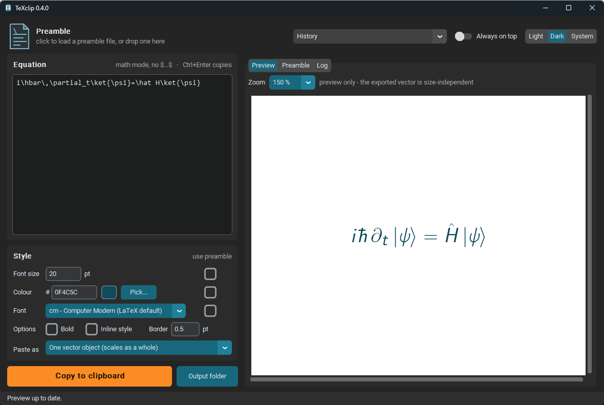

<p align="center"></p>

# TeXclip

**Type LaTeX math, get a real vector graphic you can paste straight into Affinity.**

Affinity Designer, Publisher and Photo have no LaTeX support. TeXclip compiles your equation with
your own TeX installation, converts every glyph to a path (so no Computer Modern font is needed
on the other side), and puts the result on the clipboard. Press `Ctrl+V` in Affinity and you have
a crisp, infinitely scalable equation. The SVG also works in Inkscape, Illustrator, Figma, etc.

| Light | Dark |
|---|---|
|  |  |

## Features

- **Live preview** that updates while you type (debounced, never blocks the window).
- **Style fields:** font size, colour (hex or colour picker), font family (Computer Modern, Latin
  Modern, Times, Palatino, Utopia, Kp, Euler, CM Bright), bold, inline/display style, border
  padding. They override your preamble, unless you tick **use preamble** next to size, colour or
  font. Then the setting from your preamble file is used, for anything more detailed than the
  fields allow.
- **Preamble icon:** click it to choose a preamble file, or drop a `.tex` file onto it. The file
  becomes your personal preamble, and the previous one is kept as a `.bak`. The *Preamble* tab
  shows the resulting preamble and copies it to the clipboard, so your paper or poster matches the
  equations you paste.
- **Modern interface** (customtkinter) with a **light, dark or system** theme.
- **Two paste modes:** one scalable object, or curves with every glyph individually editable.
- **Text blocks:** whole paragraphs with math, justified by LaTeX (not line by line), in a frame of
  exactly the size you set, with Affinity's alignment options.
- **Baseline anchor for equations inside text:** TeXclip measures the TeX depth and shows the
  baseline shift to enter in Affinity's Character panel (see *Anchor* below).
- Equation history, remembers your settings, "always on top" so it can float next to Affinity.
- Also a **command-line tool** for scripts and batch conversion.

## Requirements

| | |
|---|---|
| Python | 3.9 or newer, with tkinter (included with the standard installers). `pip install .` also installs `customtkinter` and `tkinterdnd2`. |
| TeX | A distribution that provides `latex`, `dvisvgm` and `dvipng`: [MiKTeX](https://miktex.org) (Windows), [TeX Live](https://tug.org/texlive/) (Linux), [MacTeX](https://tug.org/mactex/) (macOS). Missing LaTeX packages are installed on first use by MiKTeX (a pop-up may appear). |
| Clipboard | Windows: built in (PowerShell). macOS: built in (`osascript`). Linux: `xclip`. |

Ghostscript is **not** needed.

## Install and run

```bash
git clone https://github.com/gollm01/TeXclip.git
cd TeXclip
pip install .            # adds the commands  texclip-gui  and  texclip
texclip-gui
```

Or without installing: double-click `run_gui.pyw` (Windows) or run `python run_gui.pyw`.

### Desktop icon

```bash
texclip --shortcut        # or: python -m texclip --shortcut
```

puts a **TeXclip** shortcut with the app icon on your desktop (Windows `.lnk`, Linux `.desktop`);
double-click it to start the app without a console window. The same icon is used in the window's
title bar and on the taskbar button. The taskbar button gets its own identity, so it shows the
TeXclip icon even with the Microsoft Store Python. To pin it to the taskbar, right-click the shortcut or the
running app and choose *Pin*. The icon sources are in `src/texclip/assets/`; edit the shapes in
`tools/make_icon.py` and re-run it to restyle (needs Pillow).

## Using the GUI

1. Type the equation in math mode, **without** `$...$`. Text goes in `\text{...}`.
   `align`, `gather` and `equation` environments are fine; they are shrunk to fit.
2. Adjust size, colour and font on the left. The preview follows after half a second.
3. Press **Ctrl+Enter** (or *Copy to clipboard*), then **Ctrl+V** in Affinity.
4. *Preamble* tab > **Copy preamble** copies the matching LaTeX preamble for your document.

| Shortcut | Action |
|---|---|
| `Ctrl+Enter` | build SVG and copy it |
| `F5` | recompile the preview |

### Your personal preamble

Your own packages and macros live in `~/.texclip_preamble.tex`. To replace it, click the
**preamble icon** or drop a file onto it. A complete `.tex` file works too, because
`\documentclass` and everything from `\begin{document}` on are dropped. To edit it, use
*Preamble* tab > *Edit file*. A leftover `~/.tex2aff_preamble.tex` from the earlier script is
picked up if the new file does not exist. The preamble is inserted after the base packages
(`amsmath`, `amssymb`, `mathtools`, `physics`, `xcolor`).

By default the **Style** fields win: font packages (`lmodern`, `helvet`, `newtxmath`, ...),
`\color`, `\pagecolor`, `\fontsize` and bare size switches in that file are neutralised. Tick
**use preamble** next to a field to keep the preamble's setting instead. For example, keep a
`helvet` + `mathastext` set-up as the font, or a `\fontsize{24}{29}\selectfont`. Size lines are
moved into `\AtBeginDocument` automatically, because LaTeX resets the size at `\begin{document}`.
The *Preamble* tab lists exactly what was replaced.

Notes: the preamble has to work with plain `latex` (DVI), not XeLaTeX/LuaLaTeX; TikZ and pstricks
need Ghostscript for `dvisvgm`; `braket` clashes with `physics`.

### Paste modes

| Mode | Result in Affinity |
|---|---|
| **object** (default) | the whole equation is one curve (one per colour), scales as a whole |
| **curves** | one curve per glyph, each selectable and editable |

On Windows, the SVG goes on the clipboard under the format names Affinity reads:
`image/x-inkscape-svg` (Inkscape's) and `Scalable Vector Graphics` (Illustrator's).
`image/svg+xml` is added for other programs. Glyph references are resolved into plain paths first.
If pasting fails, drag the `.svg` from the output folder onto the canvas or use *File > Place*.

### Equations inside text: the Anchor option

When a text cursor is active in Affinity, Ctrl+V inserts the equation as an inline object.
Affinity puts the **bottom edge of the SVG box on the text baseline**. The *Anchor* setting
decides where that bottom edge is:

| Anchor | Bottom of the box | Result |
|---|---|---|
| **baseline** (default) | the TeX box plus the border: `dp` + border below the math baseline | TeXclip shows the **baseline shift**. With that shift applied, the math baseline sits on the text baseline. |
| **ink** | the lowest ink, e.g. the `g` of `t_g` | the original behaviour. Equations with depth (subscripts, descenders, fractions) sit too high. |
| **baseline-crop** (experimental) | the math baseline. The box is cut there and `overflow="visible"` is set. | no shift needed, if Affinity draws the part below the box. It may clip subscripts. |

TeX measures the height, depth and width of the math (`\sbox` + `\typeout` into the log). In
*baseline* mode `dvisvgm --bbox=papersize` makes the SVG box exactly the TeX box plus the border.
The shift is `-(dp + border) * 72/72.27` pt, i.e. TeX pt converted to Affinity pt. Multi-line
environments (`align`, `gather` …) get a vertically centred baseline from TeX, as usual.

Workflow for an equation inside a text frame:

1. Copy the equation in TeXclip. The line *Baseline shift: −3.47 pt* appears under the preview.
2. In Affinity, place the text cursor and press **Ctrl+V**.
3. Back in TeXclip, click **Copy value**. Only the number goes to the clipboard, replacing the
   equation, which is why you paste the equation first.
4. In Affinity, select the pasted equation like a character (Shift+Arrow), open the
   **Character panel**, and paste into **Baseline shift**.

The value is only correct if the equation is pasted at **100 %**. Scaling the pasted object
scales the needed shift too. The shift is stored in the history, so re-copying an old equation
shows its value again. The CLI prints it as `baseline shift: -3.47 pt` after the output path.

### Text blocks: whole paragraphs set by LaTeX

Affinity justifies text **line by line**. LaTeX breaks a **whole paragraph at once**
(Knuth–Plass), with hyphenation and microtype, so word spacing stays even. Switch the editor to
**Text block**, write normal LaTeX text with `$...$` math (an empty line starts a new
paragraph), and set:

| Setting | Meaning |
|---|---|
| **Frame** | width × height in mm, pt, cm or in. Leave the height empty and the block is as tall as the text. With a fixed height, TeXclip warns when the text does not fit. |
| **Alignment** | as in Affinity: Justify Left / Centre / Right / All, Align Left / Centre / Right |
| **Spacing** | line spacing (× font size), gap between paragraphs, first-line indent |
| **Hyphenation** | on or off |

Font, size, colour and bold come from the *Style* fields, or from your preamble. The pasted
object is exactly the frame size when pasted at 100 %. Here *pt* means Affinity's point (TeX's
`bp`), so 300 pt in TeXclip is 300 pt in Affinity. The text arrives as curves: edit it in
TeXclip, not in Affinity. The editor keeps your equation and your text block separately, and the
history marks text blocks with `[text]`. The preview draws a thin grey frame around the box,
which the exported SVG does not contain.

## Command line

```powershell
texclip 'E = mc^2'
texclip -s 14 -c 1f4e79 --font times '\bra{\psi}\hat H\ket{\psi}'
texclip --paste curves '\int_0^\infty e^{-x^2}\,dx'
texclip -f equations.txt          # one equation per line -> files only
texclip -i -s 12 --font palatino  # interactive loop
texclip --fonts                   # list the font styles
texclip -s preamble --font preamble 'x^2'   # size and font from the preamble file
texclip -s 30 't_g'                         # prints: baseline shift: -9.05 pt
texclip --anchor ink 't_g'                  # old behaviour: box ends at the lowest ink
texclip --text --width 90mm --align justify-left -s 12 'A paragraph with $x^2$ ...'
```

In PowerShell use single quotes (`cmd.exe` treats `^` as an escape character).
Output goes to `~/texclip/` (override with the `TEXCLIP_DIR` environment variable).

## How it works

```
equation -> standalone LaTeX document -> latex (DVI) -> dvisvgm --no-fonts -> SVG (glyphs as paths)
                                                    \-> dvipng -> PNG (preview only)
SVG -> clipboard (file-drop list and/or image/svg+xml) -> Ctrl+V in Affinity
```

`dvisvgm` on DVI input outlines glyphs without Ghostscript. `fix-cm` and `anyfontsize` allow
any point size, and `standalone` crops tightly to the equation.

## Project layout

```
src/texclip/core.py   preamble, LaTeX generation, build, preview, clipboard (no dependencies)
src/texclip/cli.py    command-line interface
src/texclip/gui.py    customtkinter application
src/texclip/shortcut.py  desktop shortcut, taskbar identity, icon paths
src/texclip/assets/   icon (SVG, PNG, multi-size ICO)
tools/make_icon.py    regenerates the icon files
tests/                pytest suite (compile tests skip themselves without TeX)
```

## Development

```bash
pip install -e .[dev]
pytest
```

## Known limitations

- Dropping a file onto the preamble icon needs `tkinterdnd2` (installed with TeXclip). Clicking
  the icon always works.
- Tested on Windows 11 with MiKTeX. The macOS and Linux clipboard paths are kept from the original
  script but not tested by the author.
- Only fonts available as `pdflatex`/`latex` packages are offered (no OpenType via `fontspec`).

## License

[MIT](LICENSE)
