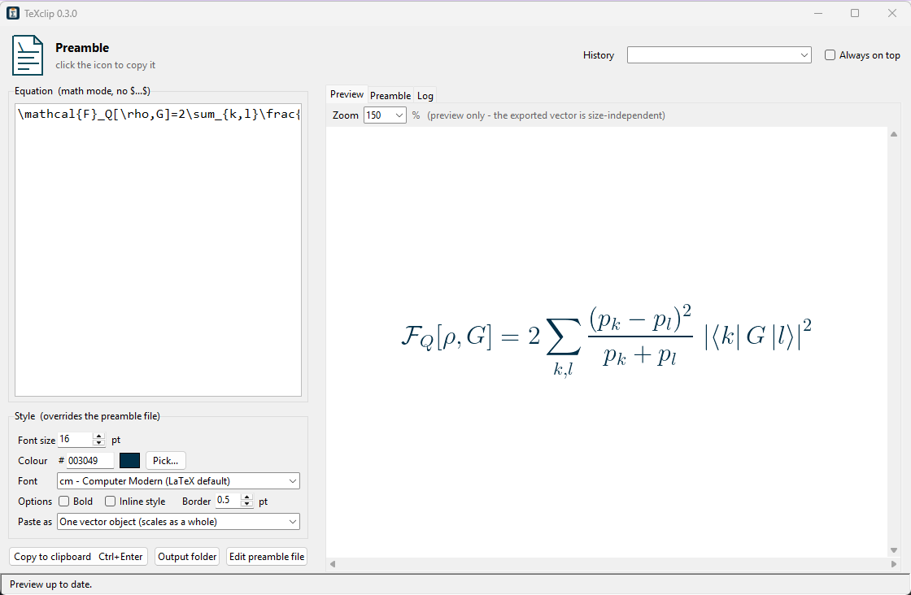

<p align="center"></p>

# TeXclip

**Type LaTeX math, get a real vector graphic you can paste straight into Affinity.**

Affinity Designer, Publisher and Photo have no LaTeX support. TeXclip compiles your equation with
your own TeX installation, converts every glyph to a path (so no Computer Modern font is needed
on the other side), and puts the result on the clipboard. Press `Ctrl+V` in Affinity and you have
a crisp, infinitely scalable equation. The SVG also works in Inkscape, Illustrator, Figma, etc.



## Features

- **Live preview** that updates while you type (debounced, never blocks the window).
- **Style fields that override your preamble:** font size, colour (hex or colour picker), font
  family (Computer Modern, Latin Modern, Times, Palatino, Utopia, Kp, Euler, CM Bright), bold,
  inline/display style, border padding.
- **Preamble icon:** one click copies the *personalised* preamble (your font, packages and personal
  macros, with the chosen colour as `eqcolor`) so your paper or poster matches the equations you
  paste. With the optional `tkinterdnd2` package you can also drag the icon into an editor.
- **Two paste modes:** one scalable object, or curves with every glyph individually editable.
- Equation history, remembers your settings, "always on top" so it can float next to Affinity.
- Also a **command-line tool** for scripts and batch conversion.

## Requirements

| | |
|---|---|
| Python | 3.9 or newer (tkinter is included with the standard installers). No other Python packages. |
| TeX | A distribution that provides `latex`, `dvisvgm` and `dvipng`: [MiKTeX](https://miktex.org) (Windows), [TeX Live](https://tug.org/texlive/) (Linux), [MacTeX](https://tug.org/mactex/) (macOS). Missing LaTeX packages are installed on first use by MiKTeX (a pop-up may appear). |
| Clipboard | Windows: built in (PowerShell). macOS: built in (`osascript`). Linux: `xclip`. |

Ghostscript is **not** needed.

## Install and run

```bash
git clone https://github.com/gollm01/TeXclip.git
cd TeXclip
pip install .            # adds the commands  texclip-gui  and  texclip
texclip-gui
```

Or without installing: double-click `run_gui.pyw` (Windows) or run `python run_gui.pyw`.

### Desktop icon

```bash
texclip --shortcut        # or: python -m texclip --shortcut
```

puts a **TeXclip** shortcut with the app icon on your desktop (Windows `.lnk`, Linux `.desktop`);
double-click it to start the app without a console window. The same icon is used in the window's
title bar and as the taskbar button. To pin it to the taskbar, right-click the shortcut or the
running app and choose *Pin*. The icon sources are in `src/texclip/assets/`; edit the shapes in
`tools/make_icon.py` and re-run it to restyle (needs Pillow).

## Using the GUI

1. Type the equation in math mode, **without** `$...$`. Text goes in `\text{...}`.
   `align`, `gather` and `equation` environments are fine; they are shrunk to fit.
2. Adjust size, colour and font on the left. The preview follows after half a second.
3. Press **Ctrl+Enter** (or *Copy to clipboard*), then **Ctrl+V** in Affinity.
4. Click the **document icon** at the top left to copy the matching LaTeX preamble.

| Shortcut | Action |
|---|---|
| `Ctrl+Enter` | build SVG and copy it |
| `F5` | recompile the preview |

### Your personal preamble

Put your own packages and macros in `~/.texclip_preamble.tex` (button *Edit preamble file*; a leftover `~/.tex2aff_preamble.tex` from the earlier script is picked up if the new file does not exist). They
are inserted after the base packages (`amsmath`, `amssymb`, `mathtools`, `physics`, `xcolor`).
The **Style** fields always win: font packages (`lmodern`, `newtxmath`, ...), `\color`,
`\pagecolor`, `\fontsize` and bare size switches in that file are neutralised automatically, and
the *Preamble* tab lists exactly what was replaced.

Notes: the preamble has to work with plain `latex` (DVI), not XeLaTeX/LuaLaTeX; TikZ and pstricks
need Ghostscript for `dvisvgm`; `braket` clashes with `physics`.

### Paste modes

| Mode | Result in Affinity |
|---|---|
| **object** (default) | one embedded vector object, scales as a whole |
| **curves** | converted to curves, every glyph selectable and editable |
| **both** | pastes both at once (rarely wanted) |

If pasting fails, drag the `.svg` from the output folder onto the canvas or use *File > Place*.

## Command line

```powershell
texclip 'E = mc^2'
texclip -s 14 -c 1f4e79 --font times '\bra{\psi}\hat H\ket{\psi}'
texclip --paste curves '\int_0^\infty e^{-x^2}\,dx'
texclip -f equations.txt          # one equation per line -> files only
texclip -i -s 12 --font palatino  # interactive loop
texclip --fonts                   # list the font styles
```

In PowerShell use single quotes (`cmd.exe` treats `^` as an escape character).
Output goes to `~/texclip/` (override with the `TEXCLIP_DIR` environment variable).

## How it works

```
equation -> standalone LaTeX document -> latex (DVI) -> dvisvgm --no-fonts -> SVG (glyphs as paths)
                                                    \-> dvipng -> PNG (preview only)
SVG -> clipboard (file-drop list and/or image/svg+xml) -> Ctrl+V in Affinity
```

`dvisvgm` on DVI input outlines glyphs without Ghostscript. `fix-cm` and `anyfontsize` allow
any point size, and `standalone` crops tightly to the equation.

## Project layout

```
src/texclip/core.py   preamble, LaTeX generation, build, preview, clipboard (no dependencies)
src/texclip/cli.py    command-line interface
src/texclip/gui.py    tkinter application
src/texclip/shortcut.py  desktop shortcut and icon paths
src/texclip/assets/   icon (SVG, PNG, multi-size ICO)
tools/make_icon.py    regenerates the icon files
tests/                pytest suite (compile tests skip themselves without TeX)
```

## Development

```bash
pip install -e .[dev]
pytest
```

## Known limitations

- Drag-and-drop of the preamble icon needs `pip install tkinterdnd2` and was only
  smoke-tested; clicking always works.
- Tested on Windows 11 with MiKTeX. The macOS and Linux clipboard paths are kept from the original
  script but not tested by the author.
- Only fonts available as `pdflatex`/`latex` packages are offered (no OpenType via `fontspec`).

## License

[MIT](LICENSE)
